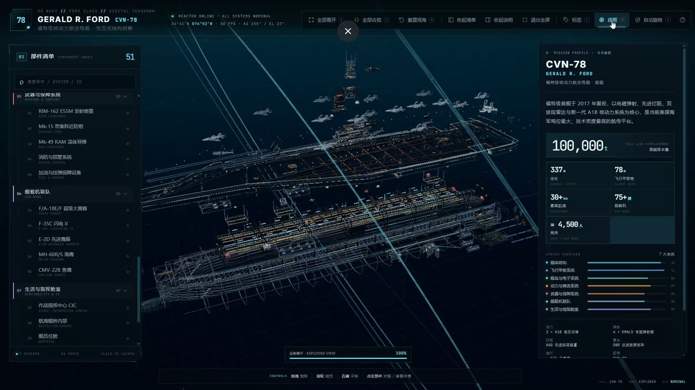
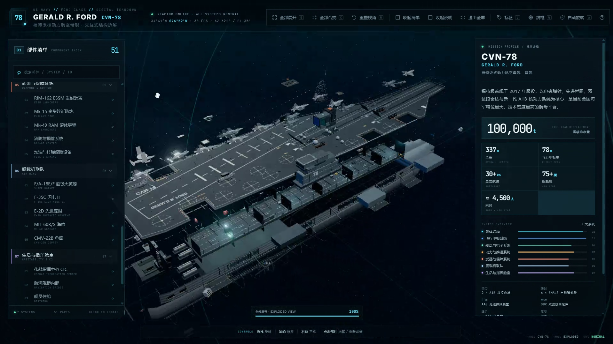
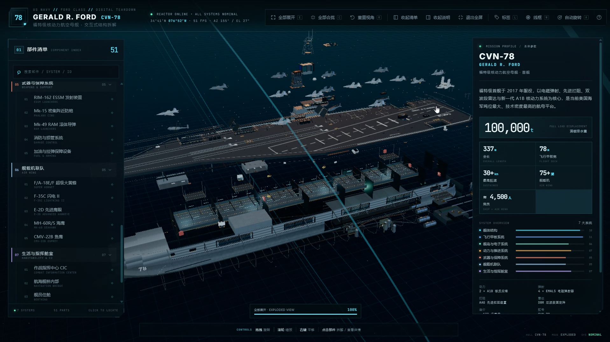

# Three.js Procedural Teardown

**English** · [简体中文](README.zh-CN.md)

An open-source **agent skill** for turning a short object prompt into a
complete, interactive 3D exploded-view page — built entirely from procedural
Three.js geometry, Canvas2D textures and vanilla HTML/CSS/JS.

> “Make an interactive 3D teardown of a Leopard 2 tank.”
> “做一个涡扇发动机的爆炸图，深色科技风，点击部件显示参数。”
> “Visualize this espresso machine's internal structure for a product launch.”

The skill researches references, plans the systems, builds the geometry layer
by layer, wires the interaction contract, QA-s the screenshots and packages the
result as one offline HTML file.

## Demo: a Ford-class carrier from one brief

The three screenshots below were produced with this skill from the
[carrier demo brief](demo/README.md). **The carrier source code is intentionally
not included in this repository** — the demo exists to show the expected output
quality.

### 01 · Exploded wireframe view



### 02 · Exploded systems view



### 03 · Component inspection view



The demo shows the interaction contract in use: full-system exploded layers,
wireframe inspection, named component tree, hovered part, persistent parameter
panels, labels, and progress feedback.

## What the skill produces

- 5–9 systems and typically 20–80 interactive parts.
- A recognizable silhouette from top, front and three-quarter views.
- Procedural hulls, decks, fuselages, casings, wings, rotors, frames and pipes.
- Canvas-generated panel seams, markings, radar grids, grilles and hazard
  stripes.
- Click-to-explode with easing; click again or blank space to collapse.
- Hover highlight and tooltip; selected outline and pulsing halo.
- Part dossier with specs and a “locate this part” camera move.
- Searchable part tree; callout labels; expand/collapse/reset/wireframe/auto
  rotate.
- Loading progress, onboarding and a responsive desktop/mobile HUD.
- One offline HTML, with no external model, texture, font or UI dependencies.

## Install as an agent skill

Copy this repository folder into the skills directory used by your agent:

```text
~/.agents/skills/threejs-procedural-teardown/
```

or, for project-local skills:

```text
.agents/skills/threejs-procedural-teardown/
```

The exact directory depends on the agent runtime (Codex, Claude Code, Cursor,
DeepSeek Harness, etc.). The key is that `SKILL.md` sits at the root of the
installed skill folder.

Then prompt the agent normally:

```text
Use the threejs-procedural-teardown skill to build an interactive 3D teardown
of a Leopard 2A7 tank. Use public references for proportions. Dark technical
style, cyan accent, one offline HTML, include a part tree and mobile layout.
```

中文示例：

```text
用 threejs-procedural-teardown 技能，把一台双锅炉咖啡机做成交互式 3D 拆解页。
要求程序化建模、可点击爆炸、部件清单、参数详情、桌面和手机适配。
```

## Quick start for developers

Requirements: Node.js 20+, npm, and Chromium/Chrome for screenshots.

```bash
npm install
npx playwright install chromium

# inside a generated project folder:
node scripts/build-page.mjs <project-folder>
node scripts/screenshot.mjs <project-folder>/dist/<name>.html --out <project-folder>/shots
node scripts/validate.mjs <project-folder>/dist/<name>.html <project-folder>

# repo self-check
npm run check
```

A generated project needs:

```text
main.js        module entry
style.css      page CSS
src/           model, data, stage, UI modules
build.json     optional title/slug/language
```

The build output is one `dist/<name>.html` that opens from `file://` and makes
no network requests.

## Repository layout

```text
threejs-procedural-teardown/
├── SKILL.md                       # agent instruction file
├── README.md                      # English README
├── README.zh-CN.md                # 简体中文 README
├── LICENSE
├── THIRD_PARTY_NOTICES.md
├── package.json
├── scripts/
│   ├── build-page.mjs             # esbuild → one self-contained HTML
│   ├── screenshot.mjs             # Playwright QA screenshots
│   ├── validate.mjs               # offline/encoding/size/runtime checks
│   └── check-skill.mjs            # repository self-check for CI
├── references/
│   ├── production-pipeline.md
│   ├── data-model.md
│   ├── threejs-cookbook.md
│   ├── reference-research.md
│   ├── qa-checklist.md
│   ├── case-carrier-demo.md       # lessons from the carrier demo
│   └── prompt-template.md
├── demo/
│   └── README.md                  # the carrier demo brief and screenshots
├── assets/demo/                   # the three demo screenshots
├── evals/                         # example evaluation prompts
└── .github/workflows/build.yml
```

## Scripts

| Script | Purpose |
|---|---|
| `build-page.mjs` | Bundle a project with esbuild into one offline HTML. |
| `screenshot.mjs` | Capture overview / exploded / top / mobile and fail on runtime errors. |
| `validate.mjs` | Check inline assets, encoding, bundle size and mount point. |
| `check-skill.mjs` | Verify the repository structure, docs and demo assets. |

The screenshot harness understands this standard runtime API:

```js
window.APP = {
  ready: true,
  expandAll(),
  collapseAll(),
  setView('hero' | 'top' | 'front'),
  select(id, fly),
};
```

Generated projects should expose `window.APP`. (The screenshot harness still
accepts a `window.CVN78` alias for projects that already use that name.)

## The workflow the skill enforces

```text
reference dossier
      ↓
systems + part data
      ↓
working app shell
      ↓
silhouette → structure → systems → detail
      ↓
materials + procedural textures + lighting
      ↓
picking · explosion · dossier · labels · HUD · mobile
      ↓
build → screenshots → inspect → iterate
      ↓
self-contained HTML + source + README
```

Two rules are non-negotiable:

1. **Reference first.** A beautiful model with the wrong silhouette is wrong.
2. **Screenshot before “done.”** If you have not inspected the top/front/mobile
   renders, you do not know what you built.

## Carrier demo

The demo in [demo/README.md](demo/README.md) is the result of a single long
brief for a Ford-class carrier. It is included **only as screenshots**, not as
source code:

- 7 systems and 51 interactive parts.
- Procedural hull, hangar, deck elevators, flight deck, 4 EMALS, AAG and IFLOLS.
- Island with bridge, Pri-Fly, CIC, DBR arrays, mast, SATCOM and funnel.
- Two A1B reactors, steam generators, turbines, shafts and propellers.
- Aircraft, weapons, damage control and habitability spaces.
- Desktop HUD, part tree, labels, exploded layers and mobile layout.

The screenshots demonstrate the visual/interaction bar the skill aims for. They
are not a template to recolor, and the source is deliberately absent.

## Example prompts

- “Build an interactive exploded view of the Space Shuttle orbiter. 7 systems,
  procedural thermal tiles, clickable SSME, cargo bay and avionics.”
- “把一台双锅炉意式咖啡机做成深色科技风的 3D 拆解页，包含锅炉、冲煮头、泵、
  水箱、磨豆机和电子控制，支持标签开关和移动端。”
- “Create a cutaway visualization of a human heart for a science museum. Use
  anatomical layers, not mechanical systems. Soft red/blue palette, clickable
  valves and a dossier for each chamber.”
- “做一个主战坦克的三维爆炸图，顶部/前视轮廓要准，履带和负重轮可单独拆解。”

## Design principles

- Navy gray / graphite / one cyan accent for military and technical subjects;
  adapt the palette to the subject rather than copying the demo.
- Dark background, but keep the object brighter than the background.
- Restrained bloom; use outlines, rim light and practical lights for clarity.
- One information hierarchy: model in the center, tree left, dossier right,
  controls top, guidance bottom.
- The exploded view is a **diagram**, not confetti. Each layer moves in a
  direction that explains its relationship.

## Evaluation

`evals/evals.json` contains example test prompts across mechanical, consumer,
organic and Chinese-language subjects. Run them manually with the skill loaded,
or use your agent's eval harness. The qualitative gate is in
`references/qa-checklist.md`.

## Contributing

Contributions are welcome: new procedural patterns, better mobile behavior,
QA tooling, or demo briefs. See `CONTRIBUTING.md`.

Please do not submit copyrighted reference images, third-party 3D assets or
source from the private carrier demo.

## Credits

- The reference-first, screenshot-reviewed production approach is informed by
  the public **Teardown** skill / [`whaleyxbt/claude-motion`](https://github.com/whaleyxbt/claude-motion)
  (MIT). This repository contains its own implementation and tooling.
- Built with [Three.js](https://threejs.org/) (MIT).
- The three carrier demo screenshots were provided by the project author for
  this repository.

## License

MIT. See `LICENSE` and `THIRD_PARTY_NOTICES.md`.
