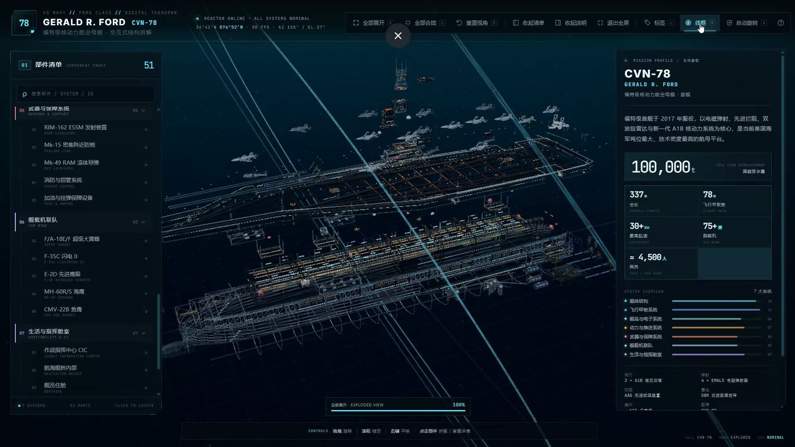
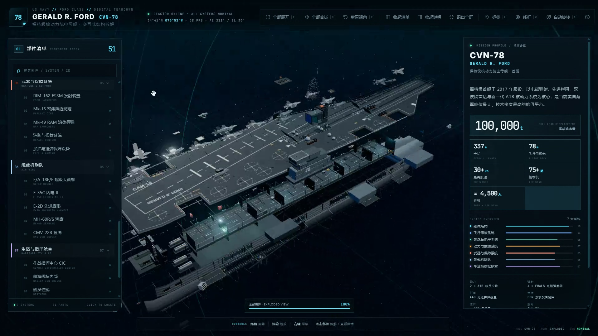
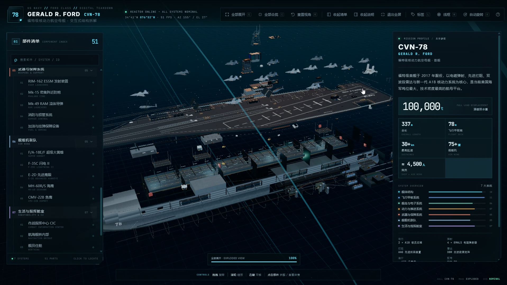

# Three.js 程序化 3D 拆解

[English](README.md) · **简体中文**

一个开源的 **Agent Skill**：用户只输入一个物体，就能生成完整的交互式 3D
爆炸拆解页面。全部几何由 Three.js 程序化生成，全部纹理由 Canvas2D 绘制，
页面只使用 HTML/CSS/JavaScript。

> “做一台主战坦克的 3D 拆解页。”
> “做一个涡扇发动机的爆炸图，深色科技风，点击部件显示参数。”
> “Visualize this espresso machine's internal structure for a product launch.”

技能会先研究参考图和真实比例，再规划系统、逐层建模、接入交互、做视觉 QA，
最后打包成一个可离线打开的单 HTML 文件。

## 演示：一份提示词生成的福特级航母

下面三张图由本项目作者使用本技能、根据
[航母 demo 提示词](demo/README.md) 实际生成。

**本仓库不包含航母源码和构建 HTML**，这三张图仅用于展示技能能达到的输出效果。

### 01 · 爆炸线框视图



### 02 · 爆炸系统视图



### 03 · 部件检查视图



演示覆盖了完整的交互契约：全部系统爆炸、线框检查、部件树、悬停部件、
参数面板、标签以及拆解进度反馈。

## 技能产出什么

- 5–9 个系统，通常 20–80 个可交互部件。
- 从俯视、前视和三分之四视角都能认出的轮廓与比例。
- 程序化生成的舰体、甲板、机身、外壳、机翼、旋翼、框架和管路。
- 用 Canvas2D 生成的甲板标线、面板接缝、雷达阵面、格栅和危险条纹。
- 点击部件沿分层方向缓动展开；再次点击或点击空白合拢。
- 悬停高亮与 Tooltip；选中部件有描边和脉冲光晕。
- 部件详情面板：功能、参数、所属系统，带“定位该部件”的相机飞行。
- 可搜索的部件树、场景标签、全部展开/合拢、重置视角、线框、自动旋转。
- 加载进度、首次进入引导、桌面和移动端响应式 HUD。
- 一个可离线打开的单 HTML，不依赖外部模型、贴图、字体或 UI 库。

## 安装为 Agent Skill

把整个仓库文件夹复制到 Agent 使用的 skills 目录，例如：

```text
~/.agents/skills/threejs-procedural-teardown/
```

或项目内：

```text
.agents/skills/threejs-procedural-teardown/
```

具体目录取决于 Codex、Claude Code、Cursor、DeepSeek Harness 等运行时；
关键是 `SKILL.md` 位于安装后的技能文件夹根目录。

然后正常提示即可：

```text
用 threejs-procedural-teardown 技能，把一台双锅炉咖啡机做成交互式 3D 拆解页。
要求程序化建模、可点击爆炸、部件清单、参数详情、桌面和手机适配。
```

English prompt：

```text
Use the threejs-procedural-teardown skill to build an interactive 3D teardown
of a Leopard 2A7 tank. Use public references for proportions. Dark technical
style, cyan accent, one offline HTML, include a part tree and mobile layout.
```

## 开发者快速开始

要求：Node.js 20+、npm，本地截图需要 Chromium 或 Chrome。

```bash
npm install
npx playwright install chromium

# 在生成的项目目录中执行：
node scripts/build-page.mjs <project-folder>
node scripts/screenshot.mjs <project-folder>/dist/<name>.html --out <project-folder>/shots
node scripts/validate.mjs <project-folder>/dist/<name>.html <project-folder>

# 本仓库自检
npm run check
```

生成项目至少需要：

```text
main.js        模块入口
style.css      页面样式
src/           模型、数据、舞台、UI 模块
build.json     可选：标题、slug、语言
```

构建结果是一个 `dist/<name>.html`，双击即可离线打开，不发起网络请求。

## 目录结构

```text
threejs-procedural-teardown/
├── SKILL.md                       # Agent 技能主入口
├── README.md                      # English README
├── README.zh-CN.md                # 本文件
├── LICENSE
├── THIRD_PARTY_NOTICES.md
├── package.json
├── scripts/
│   ├── build-page.mjs             # esbuild → 单文件 HTML
│   ├── screenshot.mjs             # Playwright QA 截图
│   ├── validate.mjs               # 离线/资源/编码/体积检查
│   └── check-skill.mjs            # 仓库结构与演示资产自检
├── references/
│   ├── production-pipeline.md     # 分阶段生产流程
│   ├── data-model.md              # 系统/部件/标签数据模型
│   ├── threejs-cookbook.md        # Three.js 几何、材质、交互技巧
│   ├── reference-research.md      # 参考资料与比例研究
│   ├── qa-checklist.md            # 视觉、交互、移动端 QA
│   ├── case-carrier-demo.md       # 航母 demo 的经验与踩坑
│   └── prompt-template.md         # 新物体提示词模板
├── demo/
│   └── README.md                  # 航母 demo 提示词 + 三张截图
├── assets/demo/                   # 三张航母演示图
├── evals/                         # 示例评测提示词
└── .github/workflows/build.yml
```

## 脚本

| 脚本 | 用途 |
|---|---|
| `build-page.mjs` | 用 esbuild 把项目打包成单文件离线 HTML。 |
| `screenshot.mjs` | 自动截取总览、爆炸、俯视、移动端；有运行时错误则失败。 |
| `validate.mjs` | 检查内联资源、编码、体积和挂载点。 |
| `check-skill.mjs` | 检查本仓库结构、文档、演示图和“无源码”规则。 |

截图脚本识别以下标准运行时 API：

```js
window.APP = {
  ready: true,
  expandAll(),
  collapseAll(),
  setView('hero' | 'top' | 'front'),
  select(id, fly),
};
```

也会兼容 `window.CVN78` 别名。生成的新项目应暴露 `window.APP`。

## 技能强制执行的工作流

```text
参考资料与尺寸
      ↓
系统拆分 + 部件数据
      ↓
可交互应用壳
      ↓
轮廓 → 结构 → 系统 → 细节
      ↓
材质 + Canvas 纹理 + 灯光
      ↓
拾取 · 爆炸 · 详情 · 标签 · HUD · 移动端
      ↓
构建 → 截图 → 人工检查 → 迭代
      ↓
单文件 HTML + 源码 + README
```

两条不可妥协的原则：

1. **先参考，再建模。** 轮廓错了，材质再漂亮也是错的。
2. **没看截图就不算完成。** 必须检查俯视、前视、移动端截图。

## 航母 Demo

[demo/README.md](demo/README.md) 中的航母是使用一段完整长提示词生成的演示：

- 7 大系统 / 51 个可交互部件
- 舰体、机库、升降机、飞行甲板、4 部 EMALS、AAG、IFLOLS
- 舰岛、航海舰桥、Pri-Fly、CIC、6 面 DBR、桅杆、卫星天线罩、烟囱
- 2 座 A1B 反应堆、蒸汽发生器、汽轮机、齿轮箱、四轴四桨
- 舰载机、武器、损管、生活与指挥舱室
- 桌面 HUD、部件树、标签、爆炸分层、移动端布局

**源码和构建产物不包含在本仓库中。** 这三张截图用于说明技能期望达到的
视觉和交互水准，并不是一个换皮模板。

## 示例提示词

- “Build an interactive exploded view of the Space Shuttle orbiter. 7 systems,
  procedural thermal tiles, clickable SSME, cargo bay and avionics.”
- “把一台双锅炉意式咖啡机做成深色科技风的 3D 拆解页，包含锅炉、冲煮头、泵、
  水箱、磨豆机和电子控制，支持标签开关和移动端。”
- “Create a cutaway visualization of a human heart for a science museum. Use
  anatomical layers, not mechanical systems. Soft red/blue palette, clickable
  valves and a dossier for each chamber.”
- “做一个主战坦克的三维爆炸图，顶部/前视轮廓要准，履带和负重轮可单独拆解。”

## 设计原则

- 军事和机械题材使用海军灰、石墨灰加单一青蓝强调色；按题材调整，不要照搬
  航母演示的配色。
- 背景可以深，但物体必须比背景亮。
- Bloom 要克制；用描边、轮廓光、实用光源提升可读性。
- 信息层级统一：模型居中，部件树在左，详情在右，工具栏在上，引导在下。
- 爆炸图是**结构示意图**，不是零件撒一地。每一层移动方向要能解释装配关系。

## 评测

`evals/evals.json` 包含机械、消费品、生物解剖、中文长提示词等测试用例。
可在加载技能后手动运行，或接入你的 Agent 评测框架。主要质量门槛见
`references/qa-checklist.md`。

## 贡献

欢迎提交新的程序化建模技巧、移动端优化、QA 工具或 demo 提示词。
详见 [CONTRIBUTING.md](CONTRIBUTING.md)。

请勿提交受版权保护的参考图、第三方 3D 资源或私有航母 demo 的源码。

## 致谢

- “先参考、后截图检查”的生产流程受到公开的 **Teardown** skill /
  [`whaleyxbt/claude-motion`](https://github.com/whaleyxbt/claude-motion)
  （MIT）启发；本仓库为独立实现和工具链。
- 使用 [Three.js](https://threejs.org/)（MIT）。
- 三张航母演示截图由项目作者提供。

## 许可

MIT，详见 [LICENSE](LICENSE) 与 [THIRD_PARTY_NOTICES.md](THIRD_PARTY_NOTICES.md)。
