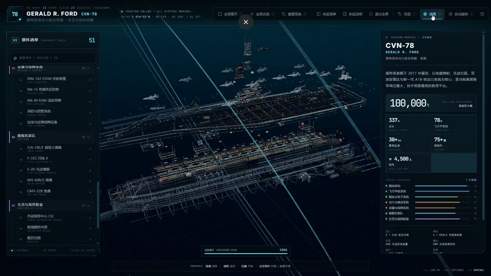
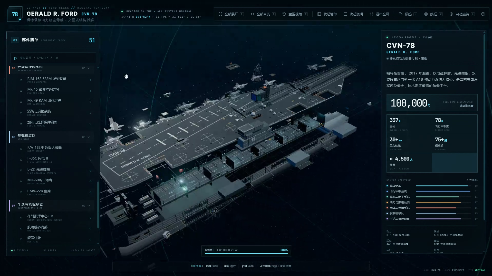
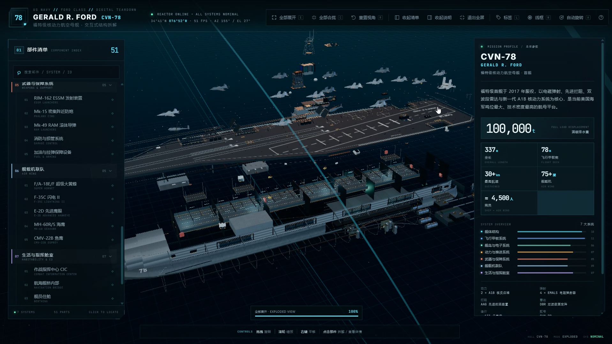

# Demo Brief — CVN-78 Ford-Class Carrier

This is the brief used to produce the demo screenshots. **The generated carrier
source code is intentionally not included in this repository.** The screenshots
are the demo artifact.

## The brief

> 使用 Three.js 创建一个完整、可交互的福特级航空母舰 3D 拆解可视化页面，
> 要求模型细节丰富、结构分层清晰、交互流畅，所有几何体与材质均由代码程序化
> 生成，不依赖任何外部 3D 模型文件。

### 1. 模型主体

以 CVN-78 杰拉尔德·R·福特号为原型，按 7 层建模：

1. **舰体结构**：舰艏（含球鼻艏）、舰艉、舷侧外飘、水线以下船体、机库甲板、
   4 部舷侧升降机（平台与导轨）、分舱隔板、龙骨与肋骨框架。
2. **飞行甲板系统**：斜角甲板与艏部起飞区、4 部 EMALS（轨道、滑块、储能装置）、
   AAG 拦阻索与拦阻网、菲涅尔透镜与着舰灯、甲板标线与停机位、弹药升降机、
   防坠网与系留点。
3. **舰岛与电子系统**：航海舰桥、飞行控制室、旗舰指挥室、6 面 DBR 双波段
   雷达阵面、电子战天线、通信桅杆、卫星通信天线罩、烟囱。
4. **动力与推进**：2 座 A1B 反应堆（压力容器、蒸汽发生器、屏蔽层）、主汽轮机、
   减速齿轮箱、4 根推进轴与螺旋桨、舵机、应急柴油发电机。
5. **武器与保障**：ESSM 发射装置、Mk-15 密集阵、Mk-49 RAM、消防损管、
   加油与挂弹保障设备。
6. **舰载机联队**：F/A-18E/F、F-35C、E-2D、MH-60R/S、CMV-22B 简化模型，
   含折叠机翼状态，按甲板与机库停机位布置。
7. **生活与指挥舱室**：住舱、餐厅、医疗舱、CIC、航海舰桥内部、弹药库、
   航空燃油舱。

### 2. 交互

- 点击部件触发分层爆炸动画；再次点击或点击空白处合拢。
- 鼠标拖拽旋转、滚轮缩放、右键平移；触屏双指旋转与缩放。
- 点击部件弹出详情：名称、功能、关键参数、所属系统，带“定位该部件”。
- 悬停高亮与 Tooltip。
- 全部展开/合拢、重置视角、标签开关、线框、自动旋转。
- 可按系统分类搜索的部件树，点击条目定位并平滑移动相机。
- 参数区：未选中时展示航母总体参数；选中时展示部件参数。
- 操作引导、加载进度、拆解进度反馈。

### 3. 视觉

- 深蓝黑渐变、网格地面、星点/粒子、冷色环境光与轮廓光。
- 深海军灰、金属质感、青蓝色科技光效、半透明磨砂玻璃 UI。
- 选中部件轮廓描边、发光高亮与脉冲光晕。
- 世界坐标标签 + 关键参数（337 m、78 m、100,000 t、30+ kn、75+ 架、
  A1B 反应堆、EMALS 能量、约 4,500 名乘员等），标签可开关。

### 4. 技术约束

- 仅使用 Three.js + HTML/CSS/JavaScript。
- 不使用外部 3D 模型、贴图文件或第三方 UI 库。
- 几何体由 Box/Cylinder/Extrude/Lathe/Shape/BufferGeometry 组合生成。
- 材质使用 MeshStandardMaterial/MeshPhysicalMaterial，纹理由 Canvas2D 生成。
- OrbitControls、Raycaster、自写缓动、CSS2D/HTML 标签。
- 模块化代码，性能优化（merge、InstancedMesh、LOD、视锥剔除）。

## Screenshots

### Exploded wireframe

### Exploded systems

### Component inspection

## What this demo validates

- The seven-layer structural decomposition stays legible when fully exploded.
- The HUD, component tree, parameter panel and callouts remain usable at
  1917×1078.
- Wireframe inspection and exploded systems views use the same data/registry.
- Dense mechanical detail can be produced procedurally without external assets.
- A single long brief can drive a full page rather than a generic 3D demo.

## What is not included

- The generated carrier source code.
- Any reference photographs or third-party textures.
- The generated `CVN-78.html` build artifact.

The screenshots are documentation of the result, not a licence to reuse the
carrier design source.
